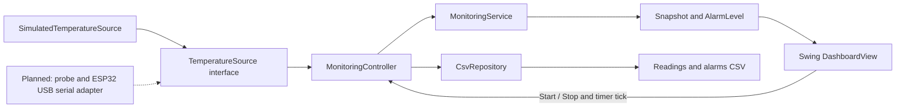

# Architecture

Each tick reads at most one sample. The service evaluates thresholds and the elapsed time since the last valid sample. The controller persists received readings and state transitions. The view renders the returned snapshot. `Clock` is injected into the controller so integration tests can advance time without sleeping.

Current sampling uses a Swing timer and local synchronous CSV writes. This is adequate for a small demonstration, but a slow disk can delay the UI. Move hardware reads and larger storage operations to a worker thread before real-device integration. The hardware latency goal is not yet measured.

The current valid-input rule accepts finite Celsius values. Physical sensor limits and serial text parsing belong in the future adapter/validation layer. Recovery hysteresis, acknowledgement and rapid-rise behavior remain unimplemented. The simulator is not a replacement for the planned hardware.
